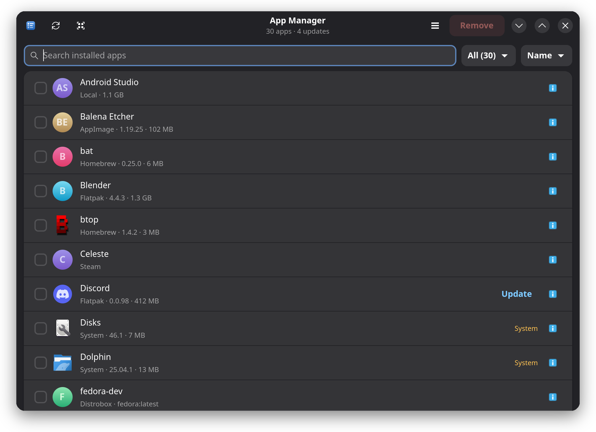
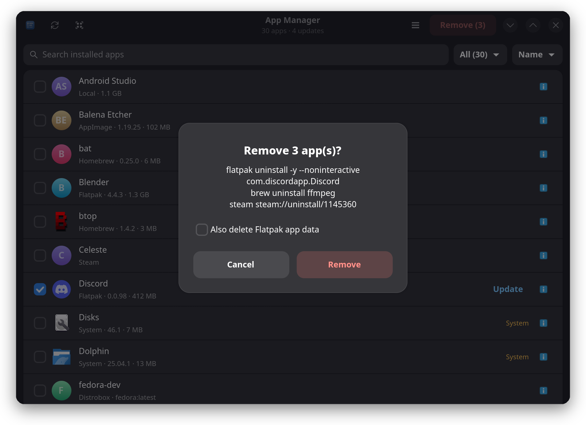
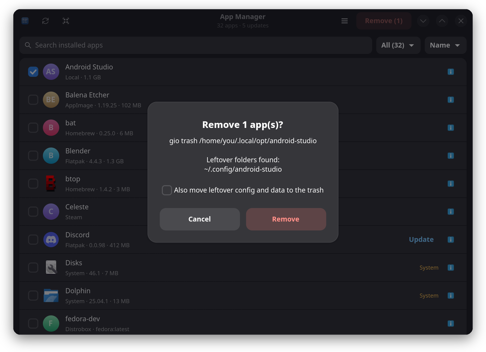
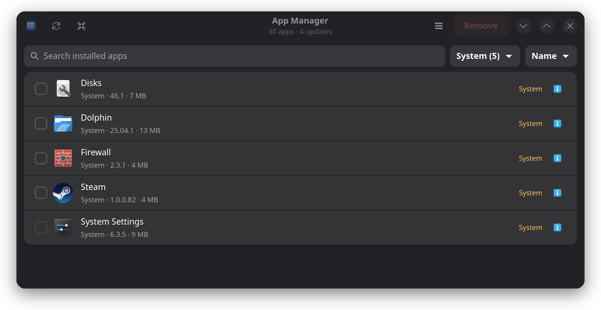

<p align="center">
  
</p>

<h1 align="center">App Manager</h1>

<p align="center">
  <b>One list of everything installed on your Linux desktop, with a checkbox and a Remove button.</b>
</p>

<p align="center">
  <a href="https://appmanager.haloman.meme">Website</a> ·
  <a href="#quick-start">Quick start</a> ·
  <a href="#what-it-finds">What it finds</a> ·
  <a href="#updates">Updates</a> ·
  <a href="#safety">Safety</a>
  <br><br>
  <a href="https://github.com/Haloman363/app-manager/actions/workflows/tests.yml"></a>
  
  
  
  
</p>

<p align="center">
  <picture>
    <source srcset="docs/assets/main-light.png" media="(prefers-color-scheme: light)">
    
  </picture>
</p>

Think Windows "Installed apps", for Linux. Flatpaks, Snaps, Homebrew, AppImages, Steam games,
containers and your distro's own packages all show up in one searchable window. Works on any
distro: Fedora (including Bazzite, Silverblue and Kinoite), Ubuntu, Debian, Arch, openSUSE and
their relatives.

## Quick start

```bash
git clone https://github.com/Haloman363/app-manager.git
cd app-manager
./install-desktop.sh     # adds "App Manager" to your application menu
./appmanager.py          # or just run it right now
```

There is nothing to build and nothing to pip install. It needs Python 3, GTK 4, libadwaita 1.5+
and PyGObject. If something is missing, App Manager tells you the command for your distro:

| Distro | Install the dependencies |
|--------|--------------------------|
| Fedora (all variants) | `sudo dnf install python3-gobject gobject-introspection gtk4 libadwaita` (already installed on KDE and GNOME) |
| Ubuntu 24.04+, Debian 13+ | `sudo apt install python3-gi gir1.2-gtk-4.0 gir1.2-adw-1` |
| Arch, Manjaro | `sudo pacman -S python-gobject gtk4 libadwaita` |
| openSUSE | `sudo zypper install python3-gobject typelib-1_0-Gtk-4_0 typelib-1_0-Adw-1` |

Debian 12 and Ubuntu 22.04 ship a libadwaita that is too old.

## How to use it

1. **Find an app.** Type anywhere to search, or pick a source from the first dropdown.
2. **Tick the checkbox** next to each app you want gone.
3. **Press Remove.** A dialog shows the exact commands before anything runs. Confirm, done.

Other things you can do:

| I want to... | Do this |
|--------------|---------|
| See details or copy the remove command | Click the **ⓘ** button on a row |
| Update one app | Click the blue **Update** button on its row |
| Update everything | **☰ menu → Update all** |
| Update apps automatically | **☰ menu → Update apps automatically (daily)** |
| Free space | **☰ menu → Remove unused Flatpak runtimes** or **Clean Homebrew cache** |
| Sort by size | Use the second dropdown (Name / Size / Source) |
| Tick everything shown | Click the select-all button, or press **Ctrl+A** |
| Reload the list | Click ⟳, or press **F5** |

| Shortcut | Action |
|----------|--------|
| Just start typing | Search |
| Ctrl+F | Focus the search box |
| F5 / Ctrl+R | Refresh |
| Ctrl+A | Select all shown (never System apps) |
| Delete | Remove the ticked apps (asks first) |

## What it finds

| Source | Where it looks | Remove does |
|--------|----------------|-------------|
| **Flatpak** | `flatpak list` | `flatpak uninstall`, with an optional "also delete app data" box |
| **Snap** | `snap list` (runtimes and bases hidden) | `snap remove` (asks for your password) |
| **Homebrew** | `brew leaves` (what you installed, not dependencies) | `brew uninstall` |
| **rpm-ostree** | packages you layered (Bazzite, Silverblue, Kinoite) | `rpm-ostree uninstall` (needs a reboot) |
| **Distrobox** | `distrobox list` | `distrobox rm -f` |
| **Toolbox** | Toolbx containers | `toolbox rm -f` |
| **AppImage** | `*.AppImage` files in common folders, plus apps with a menu launcher | Moves the file and its launcher to the trash |
| **Steam** | Steam shortcuts in your app menu | Opens Steam's own uninstall prompt |
| **Local** | Menu entries you added by hand (manual installs, web apps) | Moves the entry and its `~/.local/opt` folder or `~/.local/bin` script to the trash |
| **System** | Your distro's own apps, found through the menu entries and the package that owns each one | See below |

How **System** apps are removed depends on the distro, and it is detected automatically:

| Distro family | Command |
|---------------|---------|
| Fedora Atomic (Bazzite, Silverblue, Kinoite) | `rpm-ostree override remove` (reboot, undo with `override reset`) |
| Fedora, RHEL and clones | `pkexec dnf remove -y` |
| Debian, Ubuntu, Mint | `pkexec apt-get remove -y` |
| Arch, Manjaro | `pkexec pacman -R --noconfirm` |
| openSUSE | `pkexec zypper --non-interactive remove` |

`pkexec` shows your system's normal admin password prompt. Sources whose tools are not
installed (no `brew`, no `snap`, no `distrobox`) are skipped quietly.

## Updates

- **One app:** click **Update** on its row. Works for Flatpak, Homebrew, Snap and AppImage apps.
- **Everything:** **☰ menu → Update all**.
- **Automatically:** flip **Update apps automatically (daily)** in the ☰ menu. This installs a
  systemd user timer (`app-manager-update.timer`) that runs `./appmanager.py --update-all`
  once a day with a random delay. It updates Flatpak, Homebrew and AppImage apps and shows a
  desktop notification when it did something. Snap and your distro's packages need admin
  rights, so they stay with their own updaters (snapd already refreshes itself). Turn the
  switch off to remove the timer. Logs: `journalctl --user -u app-manager-update`.
- **AppImage updates** need [`appimageupdatetool`](https://github.com/AppImageCommunity/AppImageUpdate)
  on your `PATH`. Without it, AppImages are simply not checked.
- **App Manager itself:** a banner appears when a newer release exists. For a git checkout,
  **Update** runs `git pull --ff-only`; otherwise it opens the release page. Restart the app
  afterwards. The only network request is one anonymous call to the GitHub releases API at
  startup; set `APPMANAGER_NO_UPDATE_CHECK=1` to turn it off.

## Safety

<p align="center">
  
</p>

- **Nothing runs until you confirm**, and the dialog lists the exact commands.
- **AppImage and Local removals go to the trash**, so you can get them back.
- **Leftovers are opt-in.** If config or data folders named like the app exist (in `~/.config`,
  `~/.local/share` or `~/.cache`), the dialog lists them and a checkbox moves them to the trash.
  Nothing else is touched.
- **System apps are marked** with an amber "System" label and a warning in the dialog.
- **Select-all never picks System apps.** Native packages must be ticked by hand.
- **Core packages are locked**: desktop shells (Plasma, GNOME, Xfce, Cinnamon, MATE, Budgie),
  display managers, `systemd`, NetworkManager, polkit and the package managers themselves cannot
  be removed from here.
- Other native packages (a file manager, a terminal) *can* be removed. Read the warning first.

<p align="center">
  
</p>

<p align="center">
  
</p>

## FAQ

**Why can't I tick some apps?** They are locked: either no package owns that menu entry, or
it belongs to a protected core package. Click ⓘ to see which.

**Why do I see fewer Homebrew apps than `brew list`?** Only the formulae you installed
directly are listed. Dependencies are hidden so you can't break other tools by accident.

**Where did a removed AppImage go?** Your trash. Restore it from your file manager.

**It says "N updates" but a row has no Update button.** Update badges only appear on rows that
exist in the list, and only for sources that can be updated from here.

**Can I script it?** `./appmanager.py --list` prints every app and its remove command as
tab-separated text, without opening a window. `./appmanager.py --update-all` runs the headless
update. `./appmanager.py --version` prints the version.

## Limits

- No update check for Steam apps; Snap and native package updates are left to their updaters.
- Removing an app does not hunt down every leftover; only folders named like the app are offered.
- System package removal asks your package manager to remove dependants too (that is how
  `apt remove`, `dnf remove` and `pacman -R` work). The core-package lock covers the dangerous
  cases, but read the dialog.

## For developers

It is a single file, `appmanager.py`. Each source is a small generator function that yields
`App` records (name, source, version, size, the command that removes it). The window just
lists them.

```bash
python3 -m unittest discover -s tests -v   # parsing and safety tests, no display needed
./appmanager.py --demo                     # fake sample apps, never runs a command
./appmanager.py --shot out.png [seconds]   # save a screenshot of the window and quit
```

CI runs the tests on Ubuntu, Fedora and Arch.

## License

[MIT](LICENSE). Do whatever you like with it.
